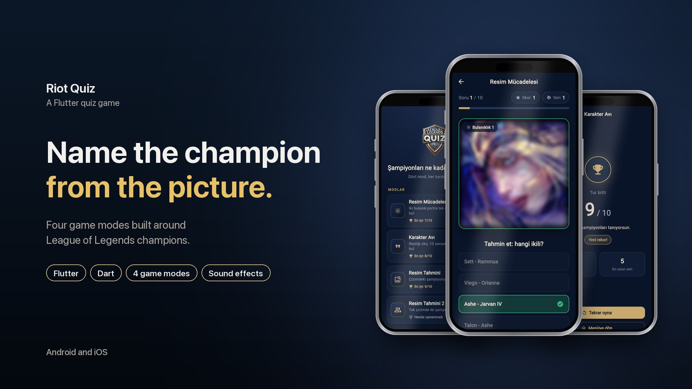
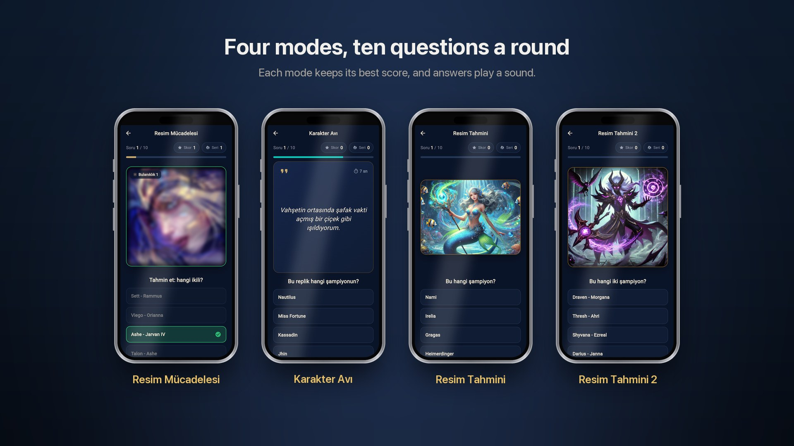
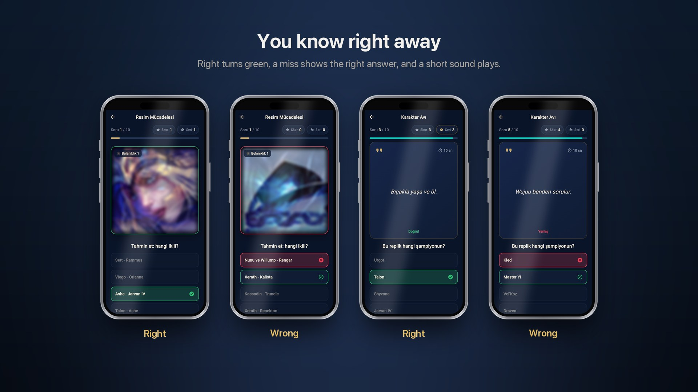
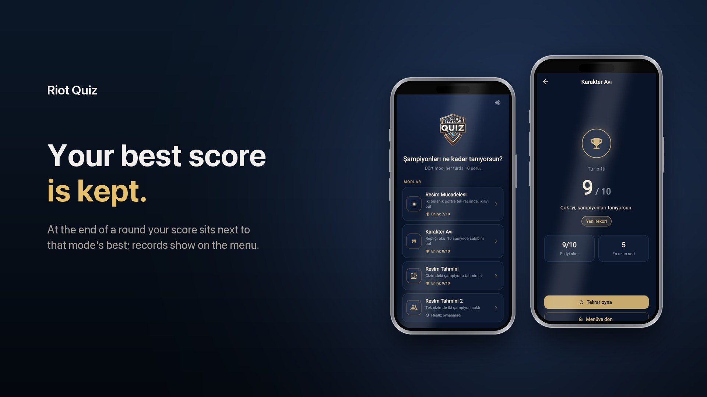
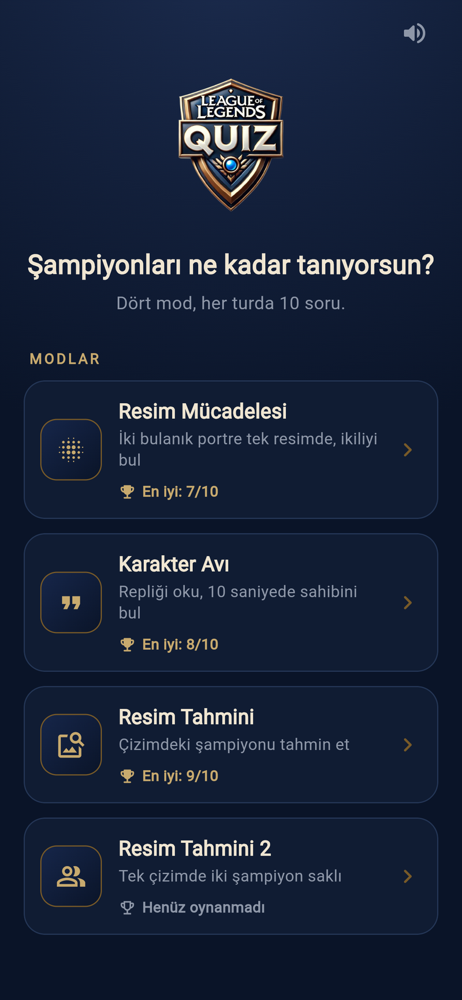
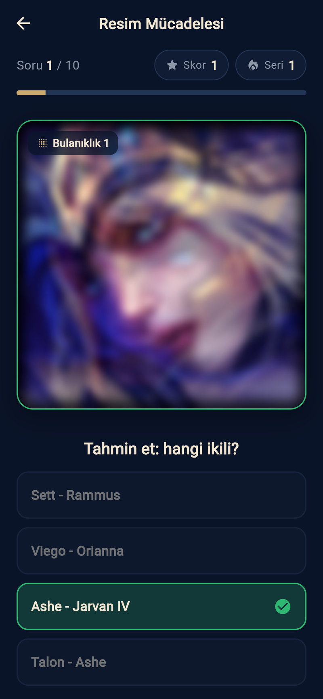
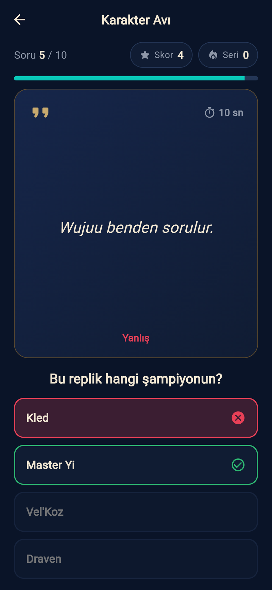
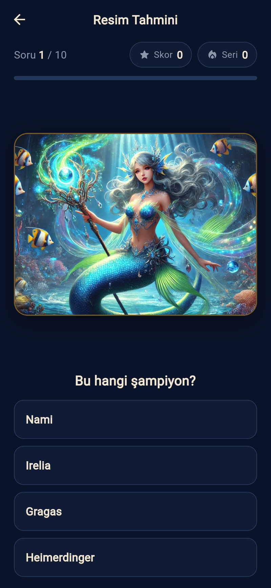

<p align="center">
  
</p>

A League of Legends quiz game with four ways to guess a champion. It runs on Android, iOS and the web, and the interface is in Turkish.

Flutter · Dart



Every round is ten questions:

- **Resim Mücadelesi:** two champion portraits blurred into one picture. Name the pair. The blur gets stronger with each correct answer in a row and resets when you miss.
- **Karakter Avı:** guess the champion from one of their lines. You have ten seconds per question.
- **Resim Tahmini:** guess the champion from an illustration.
- **Resim Tahmini 2:** the same, with two champions in one illustration.



When you answer, the button turns green or red, the right answer is shown if you missed, and a short sound plays (you can mute it from the menu). The next question comes up on its own. At the end of the round you get your score next to your best for that mode. Best scores are saved on the device and shown on the menu.





<details>
<summary>Phone screenshots</summary>
<br/>
<p>
  
  
  
  
</p>
</details>

Resim Mücadelesi downloads the champion list and portraits from Riot's Data Dragon CDN, using whatever the latest game version is, so it needs an internet connection. If the download fails it shows a retry button instead of crashing. The blur and blend run through `compute`, which keeps them off the UI thread on Android and iOS. The other three modes work offline from the pictures in `assets/images`.

There is one dark theme. The light/dark switch from earlier versions was removed.

## Running it

You need [Flutter](https://docs.flutter.dev/get-started/install) 3.47 or newer.

```bash
git clone https://github.com/omeraydin00/riotappv2.git
cd riotappv2
flutter pub get
flutter run              # emulator or device
flutter run -d chrome    # browser
```
